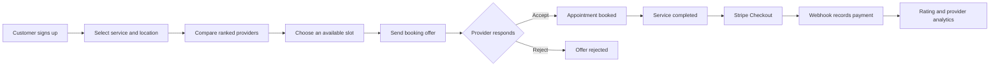

<div align="center">

# 🛠️ Services Connect

### Find trusted local service professionals, book appointments, and manage services in one place

**Full-stack service marketplace · Location-based discovery · Booking workflows · Real-time communication**

[](https://react.dev/)
[](https://expressjs.com/)
[](https://www.mongodb.com/)
[](https://socket.io/)
[](https://stripe.com/)

[Features](#key-features) · [How It Works](#how-it-works) · [Setup](#run-locally) · [API](#api-overview) · [Limitations](#engineering-notes-and-limitations)

</div>

---

## Overview

**Services Connect** is a full-stack web application for connecting customers with nearby home-service professionals. Customers can search for electricians, plumbers, carpenters, and housemaids, compare available providers, send appointment offers, communicate with providers, and pay for completed work. Providers receive booking requests, manage service appointments, and review performance statistics. An administrative interface provides complaint review and operational alerts.

The application combines service discovery, map-based onboarding, scheduled and recurring bookings, chat, payments, feedback, and analytics. English and Bangla interfaces make the service workflows accessible to a broader audience.

> **Project status:** This repository is an application prototype. The capabilities below are documented from the source code, not from a freshly executed end-to-end test. Several production-security and deployment issues are listed near the end of this README.

## Key features

| Area | Functionality present in the source |
|---|---|
| **Accounts and roles** | Customer and service-provider registration/login; JWT authentication with bcrypt password hashing; separate administrator interface. |
| **ID-assisted onboarding** | NID image upload, image preprocessing with Sharp, text extraction with Tesseract.js, and Cloudinary image storage. OCR is **not** a verified identity-checking service. |
| **Maps and location** | Location selection at signup using Leaflet / React Leaflet and OpenStreetMap; reverse-geocoded address; provider distance calculations. |
| **Provider discovery** | Search by profession, service category, and tier; optional 5 km nearby filter; ranking based on distance, estimated price, and completed jobs. |
| **Service pricing** | Tier-based starting prices plus a dynamic adjustment based on provider rating, completed jobs, pending requests, and travel distance. |
| **Availability and booking** | Three daily service slots per provider, generated for a rolling 14-day period; customer booking offers and provider accept/reject actions. |
| **Recurring appointments** | Weekly, biweekly, or approximately monthly booking requests (up to 12 occurrences); unavailable or conflicting dates are reported as skipped. |
| **Customer/provider messaging** | JWT-authenticated Socket.IO connections, offer-based conversation rooms, MongoDB message storage, and a message-history API. |
| **Payments and notifications** | Stripe Checkout in BDT, signed webhook handling, payment-status updates, provider earnings calculations, and Nodemailer completion emails. |
| **Feedback and complaints** | Service ratings/reviews and complaint submissions with optional supporting-file uploads. |
| **Admin monitoring** | Complaint review and alerts for multiple signups from one IP or unusually frequent booking offers. |
| **Provider analytics** | Completed jobs, net earnings, rating progression, monthly earnings, travel distance, and service-category statistics. |
| **Help and localization** | Groq-powered platform help chat using `llama-3.3-70b-versatile`; English/Bangla UI translations. |

### Supported service categories

| Provider | Example services |
|---|---|
| **Electrician** | Installation, repair, inspection |
| **Plumber** | Installation, repair, cleaning |
| **Carpenter** | Building, repair, installation |
| **Housemaid** | Cleaning, cooking, laundry |

Customers select a service tier (**Basic**, **Standard**, or **Advanced**) where supported by the selected category.

## How it works



**Booking details:** New provider accounts receive three slots each day—**8 AM–12 PM**, **12–4 PM**, and **4–8 PM**—for the next 14 days. A scheduled task maintains future slots. Pending offers are separate from accepted bookings; accepting an offer marks the corresponding slot booked and rejects competing pending offers for that same provider/date/time.

**Recurring bookings:** Customers can request multiple appointments on a weekly, biweekly, or 30-day interval. The API returns a per-date report of created and skipped requests. These create **offers**, not guaranteed accepted appointments.

**Pricing and provider ranking:** A rule-based formula calculates a price estimate from a category/tier starting price and provider-specific adjustments. A separate weighted recommendation score uses distance, price, and completed jobs. This is an explainable heuristic, **not** a trained AI recommendation model.

**Payment accounting:** The offer model allocates **15% commission** to the platform and **85% provider earnings**. Stripe uses Bangladeshi taka (`bdt`); the webhook updates the paid offer and the provider's earnings metrics. Payment processing requires valid Stripe credentials and webhook configuration.

## Technology stack

| Layer | Tools and libraries |
|---|---|
| **Frontend** | React 19, Vite 7, React Router, Tailwind CSS, DaisyUI |
| **Backend** | Node.js, Express 5, REST APIs |
| **Database** | MongoDB, Mongoose |
| **Authentication** | JSON Web Tokens, bcrypt, Joi validation |
| **Maps / geolocation** | React Leaflet, Leaflet, OpenStreetMap tiles, Nominatim reverse geocoding |
| **Real-time messaging** | Socket.IO, Socket.IO Client |
| **Payments** | Stripe Checkout and webhook events |
| **File processing** | Multer, Cloudinary, Sharp, Tesseract.js OCR |
| **Email** | Nodemailer (Gmail SMTP configuration) |
| **AI assistance** | Groq SDK, Llama 3.3 70B Versatile |
| **Charts / metrics** | Recharts, MongoDB aggregation pipelines |
| **Scheduling** | node-cron, Moment.js |
| **Localization / feedback** | Custom React language context (English/Bangla), React Toastify |

## Project structure

```text
Services-Connect/
├── backend/
│   ├── index.js                  # Express server and Socket.IO setup
│   ├── db.js                     # MongoDB connection
│   ├── config/                   # Cloudinary and file-upload settings
│   ├── controllers/              # Auth, NID OCR, payments, pricing, complaints, AI
│   ├── cronJobs/                 # Rolling provider-slot schedule
│   ├── middlewares/              # JWT, admin check, request validation, uploads
│   ├── models/                   # Users, offers, slots, messages, complaints, alerts
│   ├── routes/                   # REST API route modules
│   ├── utils/                    # Completion-email utility
│   └── package.json
└── frontend/
    ├── src/
    │   ├── components/           # Provider cards, messaging, AI chat, language toggle
    │   ├── hooks/                # Booking offer data hook
    │   ├── i18n/                 # English/Bangla strings and language context
    │   ├── pages/                # Customer, provider, admin and account screens
    │   ├── App.jsx               # Frontend routes
    │   └── main.jsx
    ├── package.json
    ├── vite.config.js
    └── tailwind.config.js
```

## Run locally

### Requirements

- Node.js and npm (use a recent Node.js version compatible with **Vite 7**)
- A running local MongoDB instance or MongoDB Atlas connection
- External-service credentials for the features you want to exercise (Cloudinary, Groq, Stripe, Gmail)
- Two terminals, one for the backend and one for the frontend

### 1. Clone the repository

```bash
git clone https://github.com/ak-kamal/Services-Connect.git
cd Services-Connect
```

### 2. Install dependencies

In the first terminal:

```bash
cd backend
npm install
```

In a second terminal, from the repository root:

```bash
cd frontend
npm install
```

### 3. Configure backend environment variables

Create **`backend/.env`** (do not commit this file):

```dotenv
PORT=5000
MONGO_URI=mongodb://127.0.0.1:27017/services_connect
JWT_SECRET=replace_with_a_long_random_secret

CLOUDINARY_CLOUD_NAME=your_cloud_name
CLOUDINARY_API_KEY=your_cloudinary_api_key
CLOUDINARY_API_SECRET=your_cloudinary_api_secret

STRIPE_SECRET_KEY=your_stripe_test_secret_key
STRIPE_WEBHOOK_SECRET=your_stripe_test_webhook_secret

GMAIL_USER=your_email_address
GMAIL_PASS=your_gmail_app_password

# Exact spelling currently expected by ChatController.js:
GROK_API_KEY=your_groq_api_key
```

The code accesses `GROK_API_KEY` for the **Groq** SDK—this variable name is used in the current source despite the spelling difference. Keep it unless you also update the controller. Use **test-mode Stripe keys** while developing.

### 4. Configure the frontend API URL

Create **`frontend/.env.local`**:

```dotenv
VITE_API_BASE_URL=http://localhost:5000
```

Do not place private API keys in `VITE_` environment variables; Vite exposes those values to client-side code.

### 5. Start both applications

From `backend/`:

```bash
npm start
```

The current backend `start` script uses **nodemon**. It serves HTTP and Socket.IO on `http://localhost:5000` by default.

From `frontend/`:

```bash
npm run dev
```

Open **http://localhost:5173** in your browser.

> **First-run notes:** Registration requires the NID-image processing flow and Cloudinary configuration. Stripe checkout, emails, and Groq chat require their respective services. The backend uses local `uploads/` directories for complaint attachments and provider certifications, so run it from `backend/` and make sure the process has write permissions.

### 6. Test Stripe webhooks (optional)

After setting up the [Stripe CLI](https://docs.stripe.com/stripe-cli), forward sandbox events to the implemented webhook:

```bash
stripe listen --forward-to localhost:5000/api/payment/webhook
```

Use the webhook signing secret returned by Stripe CLI for `STRIPE_WEBHOOK_SECRET`. The application currently has **hardcoded localhost redirect URLs** for checkout success/cancellation; update them when deploying elsewhere.

## API overview

The server exposes these route groups. Endpoints are listed to document the code and **must not be interpreted as all having sufficient production access controls**.

| Area | Method and path | Purpose |
|---|---|---|
| Authentication | `POST /auth/signup`, `POST /auth/login` | Create account / receive JWT |
| NID OCR | `POST /auth/extract-nid` | Extract data from an uploaded NID image |
| Providers | `GET /api/providers`, `GET /api/providers/:providerId` | Search/rank providers or fetch a profile |
| Provider account | `GET /api/profile`, `POST /api/certification` | Protected profile and certification upload |
| Slots | `GET /api/slots`, `PUT /api/slots/:slotId/book` | Availability and slot booking |
| Booking offers | `POST /api/offer`, `GET /api/offers`, `GET /api/customer-offers` | Submit/view appointment requests |
| Offer lifecycle | `PUT /api/offer/:offerId/accept`, `/reject`, `/complete`, `/add-review` | Provider responses, completion, ratings |
| Recurring offers | `POST /api/recurring-booking` | Submit repeated bookings and receive skipped-date report |
| Messaging | `GET /api/messages/:offerId` | Protected offer conversation history |
| AI help | `POST /api/chat` | Platform-question assistant |
| Payment | `POST /api/payment/create-checkout-session`, `POST /api/payment/webhook` | Checkout creation and signed webhook |
| Complaints | `POST /api/complaints`, `GET /api/complaints` | Submit complaints; admin-protected complaint list |
| Alerts | `GET /api/alerts`, `PUT /api/alerts/:alertId/read` | Admin-interface operational alerts |
| Analytics | `GET /api/analytics/:providerId` and other `/api/*/:providerId` statistics endpoints | Provider performance and chart data |

**Real-time events:** The Socket.IO server uses JWT handshake authentication and supports `join_room`, `leave_room`, `send_message`, and `receive_message` events for conversations linked to booking offers. Messages are stored in MongoDB.

## Data model at a glance

- **User:** credentials, service role, location, optional ID/certification data, reputation metrics, completed jobs, earnings.
- **Slot:** provider, service date/time, booking flag.
- **Offer:** customer/provider pair, requested slot, service details, price, commission, status, rating/review.
- **Message:** conversation associated with an offer, sender, content and timestamps.
- **Complaint:** customer/provider details, description, optional attachment and status.
- **Alert:** anomaly category, message, metadata and read state.
- **ProviderTrust:** separate trust-score model included in the code; its router is not mounted in the supplied server entry point.

## Engineering notes and limitations

This is a feature-rich learning/prototype application, not a security-audited production marketplace. Areas to resolve before publicly deploying it with real user information or payments include:

1. **Authorization and sensitive responses.** Some provider-search/detail, offer-management, slot-booking, and alert endpoints are not protected by server-side authorization. Provider API responses currently include more user-model fields than public clients should receive. Use allowlisted response fields and enforce role/ownership checks on the server.
2. **Sensitive identity information.** NID uploads and OCR data require careful handling. OCR extracts text; it does not verify authenticity. Remove sensitive debug logging and set appropriate retention/access policies for identity images.
3. **Booking concurrency.** Availability is checked before offers are accepted, but a database-level atomic claim/transaction would be needed to guarantee that concurrent actions cannot double-book a slot.
4. **Payment correctness.** Protect checkout creation, verify paid-state transitions and webhook idempotency, and make Stripe success/cancel URLs configurable before production use.
5. **Deployment URLs.** The AI widget uses `http://localhost:5000/api/chat`, while Stripe redirects and an admin attachment link also reference localhost. Move these to shared environment-based URLs for remote deployments.
6. **Scheduler and trust logic.** The slot cron job depends on the server's timezone and uptime; the separate provider-trust router is not currently mounted. Review edge cases in trust-score calculations and statistics updates.
7. **Testing.** No automated test suite was included in the supplied source-only archive; the end-to-end flows and external integrations have not been re-run as part of this README review.

## Potential improvements

- Harden API authorization and response-field filtering; add privacy protections for stored NID data.
- Add transactional booking, payment-webhook idempotency, and integration tests for complete offer lifecycle.
- Centralize base-price configuration and API/client URLs; improve deployment readiness.
- Expand provider verification and strengthen reliability of trust/reputation metrics.
- Add workflow-level tests for recurring bookings, notifications, and real-time messaging.

---

<div align="center">

**Services Connect** · Connecting customers with local service professionals

[Back to my GitHub profile](https://github.com/ak-kamal)

</div>
